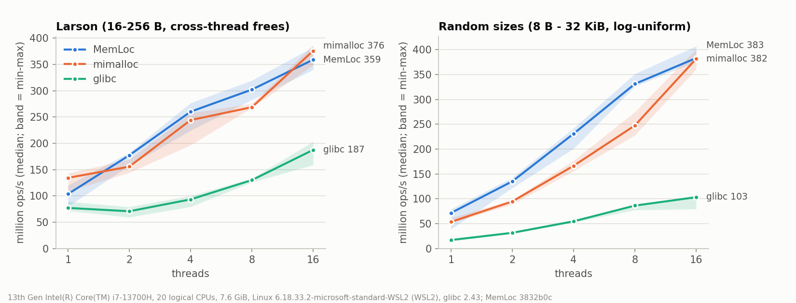
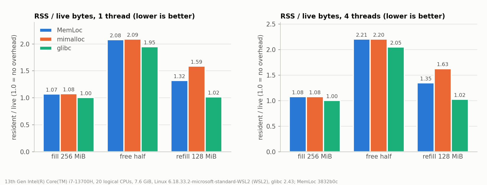
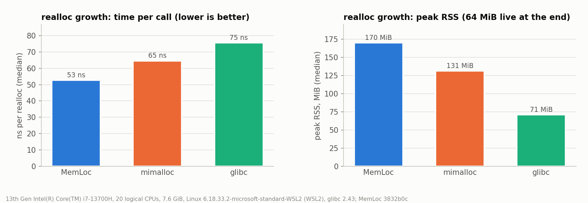

# MemLoc

A small, fast, debuggable `malloc` replacement in C++20 for Linux (x86-64 and arm64).

MemLoc is a thread-caching allocator in the tcmalloc family. It is small enough
to read in an afternoon (about 2k lines of core code), and every design choice
is written down with its trade-offs in [docs/DECISIONS.md](docs/DECISIONS.md).
It builds as:

- `libmemloc_core.a`: the allocator, exposing `memloc_malloc`, `memloc_free`, … (used by tests)
- `libmemloc.so`: a drop-in replacement that exports the whole malloc family, for `LD_PRELOAD`

## Architecture

```
malloc(n)
  ├─ n ≤ 32 KiB ──► size class (40 classes) ──► per-thread cache    (no lock, no atomics)
  │                                                 │ miss / over limit: move a batch
  │                                                 ▼
  │                                  central list per class      (mutex, alignas(64))
  │                                                 │ no span with free objects
  │                                                 ▼
  ├─ 32 KiB < n ≤ 1 MiB ─────────────► page heap: 64 KiB units in 4 MiB aligned chunks
  │                                    (64-bit occupancy bitmap per chunk)  ── mmap 4 MiB
  └─ n > 1 MiB ──────────────────────► direct mmap / mremap / munmap (64-byte header)

free(p)
  registry bit for (p >> 22) set? ── yes ─► chunk = p & ~(4 MiB-1)
                                            span  = chunk->spans[chunk->owner[unit(p)]]
                                            small → thread cache, medium → page heap
                                   └─ no ──► huge header at p-64 → munmap
```

## Deliberate non-goals

These were left out on purpose, to keep the design small enough to finish and defend:

- NUMA awareness
- huge-page (THP / hugetlbfs) tuning
- Windows or macOS support
- a lock-free central heap (central lists use a mutex per size class)
- returning small- or medium-object memory to the OS (huge blocks are unmapped on free)
- a custom `operator new`/`delete` (libstdc++'s already forward to `malloc`)

## Building

Requires Linux, CMake ≥ 3.20, and GCC ≥ 13 or Clang ≥ 17.

```sh
make test          # configure + build into ~/build/memloc and run ctest
make tsan          # ThreadSanitizer build of the unit tests
make format tidy   # clang-format check and clang-tidy
```

## Using it as a drop-in malloc

```sh
LD_PRELOAD=~/build/memloc/src/libmemloc.so sqlite3 my.db
tools/preload_demo.sh    # sqlite3 + python3 workloads, glibc vs MemLoc, outputs diffed
```

`libmemloc.so` depends only on libc. It exports the whole malloc family
(`malloc`, `free`, `calloc`, `realloc`, `reallocarray`, `posix_memalign`,
`aligned_alloc`, `memalign`, `valloc`, `pvalloc`, `malloc_usable_size`) and
is fork-safe ([D-18 to D-21](docs/DECISIONS.md)).

## Debug mode

The same library turns into a checking allocator when `MEMLOC_DEBUG=1` is
set. When the variable is unset, the malloc/free fast paths contain no
reference to the flag (see [D-22](docs/DECISIONS.md)).

```sh
MEMLOC_DEBUG=1 LD_PRELOAD=~/build/memloc/src/libmemloc.so ./my_program
MEMLOC_DEBUG=1 MEMLOC_REPORT=report.jsonl LD_PRELOAD=... ./my_program
tools/symbolize.py --text report.jsonl                # add file:line via addr2line
make bugs                                             # run the 11 bug programs in tests/bugs
```

| Detected | How |
|---|---|
| heap-buffer-overflow / underflow | 16 guard bytes before and after every block, checked on free and at exit |
| double-free, invalid-free (including interior pointers) | per-block magic numbers XORed with the address, plus a lookup of the enclosing block |
| use-after-free | freed blocks are filled with `0xDD` and held in a 4096-block / 64 MiB quarantine; the fill is checked on eviction and at exit |
| leaks | live blocks at exit, grouped by allocation stack and sorted by bytes; allocations made by libc and the loader are counted separately |
| SIGSEGV / SIGBUS | the handler runs on an alternate stack and describes the faulting address relative to the heap |

Each finding is a single JSON line, appended to the file named by
`MEMLOC_REPORT` (or written to stderr), plus a one-line summary on stderr. The record
holds the program, the thread, and the stack, plus the allocation and free
stacks with their threads. Frames are stored as module + offset. The
symbolizer turns them into this:

```
== heap-buffer-overflow at 0x7eed0b8700d0: wrote past the end of a 16-byte block: 1 of the 16 guard bytes after it changed, first at offset 16
  stack (thread 448):
    #0  main  tests/bugs/off_by_one.c:16
  alloc_stack (thread 448):
    #0  copy_name  tests/bugs/off_by_one.c:8
    #1  main  tests/bugs/off_by_one.c:14
```

Debug mode is slow on purpose: sqlite3 runs about 4× slower and python3
about 2.3× slower (see [PROGRESS](docs/PROGRESS.md#phase-4-debug-mode)).

## Statistics

`memloc_stats()` fills a `struct memloc_stats` (declared in
[memloc.h](include/memloc/memloc.h)) with the bytes mapped from the OS, the
peak mapping, bytes allocated per tier, and the free space inside small spans
and chunks. `memloc_stats_print(fd)` writes the same data plus one row per
size class. The allocation fast path keeps no counters. Instead, a snapshot
walks every chunk while holding the allocator's locks ([D-28](docs/DECISIONS.md)).

`MEMLOC_STATS=1` prints the report to stderr at exit ([D-29](docs/DECISIONS.md)).
Here it is for a python3 script that builds and serialises a 200k-element list:

```
$ MEMLOC_STATS=1 LD_PRELOAD=~/build/memloc/src/libmemloc.so python3 -c '...'
memloc stats (pid 442)
  mapped from OS     8.00 MiB
  peak mapped        42.71 MiB
  allocated          2.45 MiB
    small            2.08 MiB
    medium           0.38 MiB
    huge             0.00 MiB
  small span space   4.44 MiB
  unused chunk space 3.06 MiB
  chunks 2, huge blocks 0
  class  block B  spans  span KiB  blocks out  used %
      0       16      1        64         128       3
      1       32      1        64         256      12
  ...
     16      640      2       128         204      99
  ...
     39    32768      1       256           2      25
```

The peak is much higher than the final mapping because the list's large
arrays were huge blocks, which go back to the OS as soon as they are freed.

## Performance

MemLoc is compared with glibc 2.43 and mimalloc 3.2.8. Each allocator is
loaded with `LD_PRELOAD` into the same benchmark binaries, and every
configuration runs 5 times. The graphs show the median, and the throughput
bands span the fastest and slowest run. The methodology is in
[D-30 to D-32](docs/DECISIONS.md), the raw data is in
[bench/results](bench/results), and `make bench` reproduces everything
(about 2 minutes).

Machine: Intel i7-13700H (20 logical CPUs), 7.6 GiB, Linux 6.18 under WSL2,
gcc 15.2, MemLoc at commit 3832b0c. WSL2 and a laptop CPU with mixed P/E cores
make these numbers noisier than a dedicated server would be.



| threads | larson: MemLoc | mimalloc | glibc | random: MemLoc | mimalloc | glibc |
|---|---|---|---|---|---|---|
| 1 | 104 | **134** | 77 | **71** | 53 | 17 |
| 2 | **177** | 156 | 71 | **135** | 95 | 31 |
| 4 | **260** | 244 | 93 | **231** | 166 | 55 |
| 8 | **302** | 269 | 130 | **331** | 247 | 86 |
| 16 | 359 | **376** | 187 | **383** | 382 | 103 |

<sub>Million operations per second, median of 5 runs. Larson: 16-256 B blocks
freed by a different thread than the one that allocated them. Random: sizes
log-uniform from 8 B to 32 KiB, with a sliding window of 256 live blocks per
thread.</sub>



| phase | 1 thread: MemLoc | mimalloc | glibc | 4 threads: MemLoc | mimalloc | glibc |
|---|---|---|---|---|---|---|
| fill 256 MiB | 1.07 | 1.08 | **1.00** | 1.08 | 1.08 | **1.00** |
| free half | 2.08 | 2.09 | **1.95** | 2.21 | 2.20 | **2.05** |
| refill 128 MiB | 1.32 | 1.59 | **1.02** | 1.35 | 1.63 | **1.02** |



| realloc growth (64 buffers to 1 MiB) | MemLoc | mimalloc | glibc |
|---|---|---|---|
| time per call | **53 ns** | 65 ns | 75 ns |
| peak RSS | 170 MiB | 131 MiB | **71 MiB** |

What the numbers say, including where MemLoc loses:

- **Multi-threaded throughput is on par with mimalloc** and roughly 2-4× glibc. MemLoc
  leads mimalloc at 2-8 threads, and they are within run-to-run noise at 16
  threads (look at the bands).
- **Single-threaded larson trails mimalloc by about 22 %** (104 vs 134).
  With one thread there are no cross-thread frees, so the gap lies in the
  thread-cache fast path or its refill from the central lists. It has not been
  profiled yet. Profiling this benchmark earlier found a branch mispredict in
  the size-class computation. A lookup table fixed it
  ([D-33](docs/DECISIONS.md)) and moved MemLoc from behind glibc to ahead of it.
- **Memory overhead is not better than glibc.** glibc's boundary-tag heap
  refills the holes left by freed blocks with blocks of any size, which gives
  it 1.02 after the refill phase. MemLoc gets 1.32, because a freed small span
  can only be reused by its own size class until the whole span is empty.
  MemLoc does beat mimalloc here (1.32 vs 1.59).
- **realloc is fastest but uses the most memory.** In-place medium resizing
  ([D-34](docs/DECISIONS.md)) avoids copies. MemLoc never returns
  small or medium memory to the OS (a non-goal), so every chunk it ever used
  stays resident. glibc can grow a block in place at the end of its heap and
  trims freed memory from it.

## AI triage of bug reports

`tools/triage.py` (about 320 lines, Python standard library only) turns
a pile of debug-mode reports into one diagnosis per distinct bug:

```
reports ──► group by stack signature ──► prompt: report + source ──► LLM ──► JSON result
            (type + user functions)       (±12 lines per frame)      (schema)    type, culprit,
                                                                                 root cause, fix
```

- **Grouping** ([D-35](docs/DECISIONS.md)): the signature hashes the report type
  and the innermost 3 user-code functions of each stack. It ignores addresses,
  offsets, pids and line numbers, so repeated runs and rebuilds collapse into one group.
- **Structured output** ([D-36](docs/DECISIONS.md)): the request carries a JSON
  schema with strict decoding (`response_format.json_schema`), so the answer
  is always parseable. The client still checks `finish_reason` and
  re-validates the fields.
- **Model** ([D-40](docs/DECISIONS.md)): `openai/gpt-oss-120b` on Groq's free
  tier, called with `urllib`, so there is no SDK to install. `--model`
  chooses another Groq model. The key is read only from `GROQ_API_KEY`, and
  rate-limited requests are retried after the server's `retry-after`.
- **Eval** ([D-38](docs/DECISIONS.md)): each of the 11 programs in `tests/bugs`
  is scored against `expected.json`. Type and culprit must match exactly, and
  a second model call judges root cause and fix. Every call, including the
  prompt, raw answer, token usage and latency, goes to a JSONL trace
  ([D-39](docs/DECISIONS.md)).

```sh
export GROQ_API_KEY=...                                  # free at console.groq.com; never committed
tools/triage.py report ~/build/memloc/bug-reports/*.jsonl
make triage-eval                                         # run the bug suite, then the scored eval
make triage-eval LLM=mock                                # offline baseline, no key needed
```

Without a key, `--llm auto` falls back to a rule-based mock. It blames the
innermost user frame of the stack that the report type points at (allocation
stack for overflows and leaks, free stack for use-after-free). This baseline
gets **type 11/11 and culprit 11/11, but root cause 2/11 and fix 0/11**, so
explaining the cause and the fix is the part the model has to add. The unit
tests (`ctest -L triage`) run offline against checked-in reports. They use a
fake HTTP transport, plus a local stub server that the real client talks to.

## Design documents

- [docs/DECISIONS.md](docs/DECISIONS.md): every design decision, the alternatives considered, and the trade-offs
- [docs/WALKTHROUGH.md](docs/WALKTHROUGH.md): the path of `malloc` and `free` through the code
- [docs/CONCEPTS.md](docs/CONCEPTS.md): the OS and C++ concepts the code depends on
- [docs/PROGRESS.md](docs/PROGRESS.md): a phase-by-phase build log with measured results
